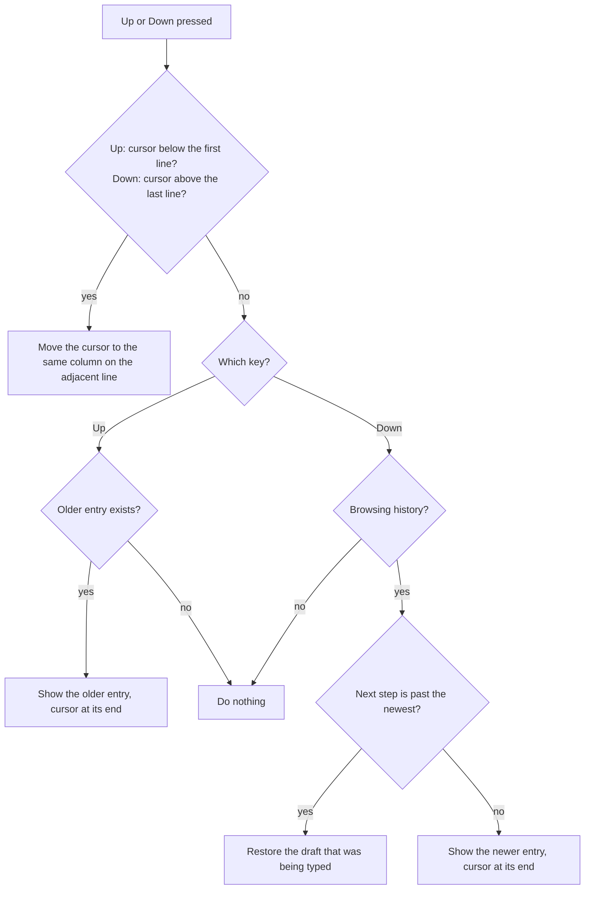
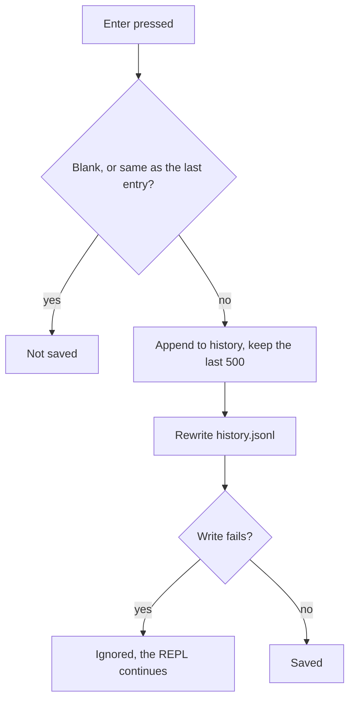

# Code Shellie

Code Shellie (`codesh`) is a Gemini-powered coding agent for your local terminal, inspired by Claude Code. You describe a task in plain language; the agent reads and writes files, runs shell commands, and reports back. It can also attach files and directories to your message and pull in tools from [Model Context Protocol](https://modelcontextprotocol.io) (MCP) servers.

- [Requirements](#requirements)
- [Installation](#installation)
- [Quick start](#quick-start)
- [Usage](#usage)
  - [Interactive mode](#interactive-mode)
  - [One-shot mode](#one-shot-mode)
  - [Slash commands](#slash-commands)
  - [Shell commands](#shell-commands)
  - [Attaching files with `@`](#attaching-files-with-)
  - [Exiting](#exiting)
- [Configuration](#configuration)
  - [API key and model](#api-key-and-model)
  - [System context](#system-context)
  - [Project context](#project-context)
- [Tools available to the model](#tools-available-to-the-model)
- [MCP servers](#mcp-servers)
- [Rate limits and errors](#rate-limits-and-errors)
- [Project layout](#project-layout)
- [Troubleshooting](#troubleshooting)

---

## Requirements

- Python 3.8 or newer. There are no third-party runtime dependencies; the package uses only the standard library.
- A Google Gemini API key ([Google AI Studio](https://aistudio.google.com/))
- Linux or macOS with a POSIX shell (`/bin/sh`) for `!command` and the `run_shell_command` tool

## Installation

Install with one command, from anywhere (needs Python 3.8 or newer and `curl`):

```bash
curl -fsSL https://raw.githubusercontent.com/nicechester/code-shellie/main/install.sh | bash
```

The one-line command fetches the installer from the latest GitHub release, then downloads that version's source into `~/.local/share/codesh/` and installs from there. If no release exists yet, it uses `main`. To install a different version, set `CODESH_REF` to a tag or commit:

```bash
curl -fsSL https://raw.githubusercontent.com/nicechester/code-shellie/main/install.sh | CODESH_REF=1.1.1 bash
```

Run the same command again to upgrade. The source is replaced each time, and the virtual environment in `~/.local/share/codesh/venv/` is reused.

If you have a clone of the repository, run the script from the project root instead:

```bash
./install.sh
```

`install.sh` is a small stub. From a checkout it runs `setup.sh`, which does the following:

1. Checks that Python 3.8 or newer is available, and stops with a message if not.
2. Finds the source: the checkout it is run from, or the downloaded archive when run through `curl`.
3. Creates the virtual environment (`venv/` in the checkout, or `~/.local/share/codesh/venv/` for the one-line install) if it is missing or broken.
4. Installs dependencies and the package in editable mode (`pip install -e`).
5. Links `~/.local/bin/codesh` to the virtual environment's `codesh` executable.
6. Warns if `~/.local/bin` is not on your `PATH`.

If the warning appears, add this to `~/.bashrc` or `~/.zshrc`:

```bash
export PATH="$HOME/.local/bin:$PATH"
```

Then open a new shell and run `codesh`.

To reinstall after moving a checkout, run `./install.sh` again. The virtual environment's scripts store absolute paths, so the script rebuilds the venv when it is broken.

## Quick start

```bash
codesh
```

On first run, if no API key is configured, Code Shellie asks for one (see [API key and model](#api-key-and-model)). Then you get a prompt:

```
codesh> summarize the README in this directory
```

## Usage

Code Shellie has two modes: interactive (the REPL) and one-shot.

### Interactive mode

Run `codesh` with no arguments. You get a `codesh>` prompt. Type an instruction and press Enter; the agent answers and may run tools along the way.

The conversation is kept for the whole session, so follow-up requests can refer to earlier ones.

#### Compact and verbose output

By default the output is compact. While the agent works, an animated `thinking...` or `working...` line shows what it is doing. Each finished tool call prints one line (`read_file called`), and a successful `write_file` prints `<path> edited`. Failed tool calls are always shown. The final answer is printed in full.

Press `Ctrl+O` at the prompt to switch to verbose output, which shows each tool's arguments and a truncated result. Press it again to go back to compact. The current view is shown in the footer after each answer. The setting is kept when the model or skills change. The switch works only at the prompt, not while the agent is running a turn.

Answers are shown with basic Markdown styling: headings, lists, block quotes, code blocks, **bold**, *italic*, and `inline code`. Other Markdown is printed as written.

Each answer ends with a footer line: the working directory and git branch, the model, the context size of the request against the model's limit, the number of files the turn wrote, tool calls, Gemini API requests made for the turn (including retries), and the current output view. `/context` also shows the Gemini API request count for the current chat.

If an answer says a change was made but the turn wrote no file, codesh prints a warning. Check with `/diff` or `git status`.

#### Multi-line prompts and copy

| Key | Action |
|---|---|
| `Enter` | Submit the prompt |
| `Alt+Enter` or `Ctrl+J` | Insert a newline without submitting |
| `Left` / `Right` | Move the cursor one character |
| `Home` / `End`, or `Ctrl+A` / `Ctrl+E` | Move to the start or end of the line |
| `Backspace` / `Delete` or `Ctrl+D` | Delete before or under the cursor. `Ctrl+D` on an empty line exits |
| `Up` / `Down` | Move between lines of a multi-line prompt. On the first or last line, recall earlier or later prompts from history |
| `Ctrl+U` | Clear the line |
| `Tab` | Complete the word before the cursor |
| `Ctrl+O` | Switch between compact and verbose output |
| Paste | A pasted multi-line block stays in one prompt and is not submitted line by line. Review it, then press `Enter` |

The prompt area grows to fit the input, and arrow keys and editing work across lines.

Submitted prompts are kept in `~/.config/codesh/history.jsonl`, one entry per line, and the last 500 are recalled with `Up` in later sessions. Blank prompts and a repeat of the previous prompt are not saved. Recalling an entry and then moving away discards any edits made to it. Commands starting with `!` or `/` are saved too.

How `Up` and `Down` choose between moving the cursor and recalling history:



When a prompt is submitted, the history is updated and saved:



To copy the agent's last answer, type `/copy`. It sends the answer's Markdown source (without the footer) to the system clipboard using the first available tool: `pbcopy` (macOS), `wl-copy` (Wayland), `xclip`, or `xsel` (X11). If none is installed, it prints a message and nothing is copied.

Completion is available as you type:

- Type `/` to list slash commands, or `/mc` to narrow it to `/mcp` (see [Slash commands](#slash-commands)).
- Type `@` to complete file and directory paths (see [Attaching files with `@`](#attaching-files-with-)).

### One-shot mode

Pass a prompt as an argument to run a single turn and exit:

```bash
codesh --version
codesh "list the Python files in src/ and explain what each one does"
codesh '!git status'
codesh /setup
```

A one-shot prompt that starts with `!` runs that shell command. A prompt that starts with `/` is a command; `/version`, `/setup`, `/clear`, `/reset`, and `/update` work in this mode. Other slash commands print `no such command` (see [Slash commands](#slash-commands)).

### Slash commands

Input that starts with `/` is a command. It never goes to the model.

| Command | Where | Description |
|---|---|---|
| `/help` | REPL | List available commands |
| `/version` | REPL, one-shot | Show the installed Code Shellie version |
| `/setup` | REPL, one-shot | Change the Gemini API key and model name |
| `/model` | REPL | Show the current model. `/model <name>` switches to that model and saves it |
| `/context` | REPL | Show the tokens in the last request against the model's limit, total tokens used this session, and Gemini API requests made in the current chat |
| `/clear` | REPL, one-shot | Clear the terminal screen. The conversation is kept |
| `/mcp` | REPL | Show configured MCP servers, their connection status, and their tools |
| `/copy` | REPL | Copy the last answer to the system clipboard |
| `/sessions` | REPL | List saved sessions with their IDs and descriptions |
| `/update [ref]` | REPL, one-shot | Install the latest `main`, or the given tag/commit, and report the installed versions |
| `/reset` | REPL, one-shot | Clear the chat and delete the current session file, so nothing is left to resume |
| `/compress` | REPL | Replace all but the last 4 turns with a summary the model writes, to free context space. The saved session keeps the compressed history, so `--resume` restores it |
| `/sources` | REPL | Show the full URLs behind the last web search. Resolves the links on demand; does not call the model |
| `/diff` | REPL | Show the diffs of the files the last turn wrote, against their contents before that turn. Files written by shell commands are not included |
| `/skills` | REPL | List installed skills and whether each one is enabled |
| `/skill enable <name>`, `/skill disable <name>` | REPL | Turn a skill on or off |
| `/<skill-name>` | REPL | Enable a skill by typing its name as a command |
| `/exit`, `/quit` | REPL | Leave the REPL |

Any other input that starts with `/` prints `no such command: /<name>` immediately and does nothing else. Nothing is sent to the model, so a typo costs no API quota.

For request-count definitions and a repeatable before/after usage comparison, see [the API usage investigation](docs/API_USAGE.md).

Note that this applies to anything starting with `/`, including paths typed as a prompt. To give the model a path, use `@` (see below) instead of starting the message with `/`.

### Skills

A skill is a reusable set of instructions the agent follows when it is enabled. Each skill is a folder with a `SKILL.md` file:

```
~/.config/codesh/skills/
└── python-test/
    └── SKILL.md
```

`SKILL.md` can start with a `description:` line, which `/skills` and completion show next to the name:

```markdown
description: Run and write Python tests with pytest

When asked to test Python code, ...
```

Create the folder and file, then:

- `/skills` lists every skill and marks the enabled ones `on`.
- `/python-test` (or `/skill enable python-test`) enables the skill. The system prompt lists it by name and description.
- Running a skill (for example `/python-test` with arguments) sends its instructions with a fixed set of rules: follow the steps in order and stop at the end, stop and ask when a step asks for confirmation, do not merge, create pull requests, push, or commit unless the message asks for it, and do not start other skills on your own.
- Typing `/python-test` with a request sends the full `SKILL.md` instructions with that message. The instructions apply to that turn only.
- `/skill disable python-test` turns it off.

Enabled skills are recorded in `~/.config/codesh/skills.json`, with each skill's description and the path to its `SKILL.md`. They stay on across sessions. Enabling or disabling a skill starts a new conversation, the same as `/model`. Older installs that have `enabled_skills.json` keep their enabled skills until the first change is saved to `skills.json`.

Skills only change the instructions. They do not add tools.

### Shell commands

Start a line with `!` to run it in your shell without involving the model:

```
codesh> !ls -la
codesh> !npm test
```

Output appears directly in the terminal. The command's exit status is not reported to the model. Use a natural-language request if you want the agent to act on the result.

### Attaching files with `@`

Put `@` followed by a path anywhere in your message to attach that file's text, or a listing of a directory, to the message sent to the message sent to the model:

```
codesh> explain what @src/code_shellie/core.py does
codesh> compare @src/code_shellie/tools.py and @src/code_shellie/mcp_client.py
```

Rules:

- The `@` must start the input or follow whitespace. Email addresses such as `user@host` are not treated as mentions.
- Paths are resolved relative to the current directory and may use `~`.
- Trailing punctuation (`.`, `,`, `;`, `:`, `!`, `?`, `)`, quotes) is ignored when the path doesn't exist as written.
- A directory attachment lists its entries, one per line, without hidden files. Directories get a trailing `/`.
- Attachments are capped at 100,000 characters; longer text is cut and marked `[truncated]`.
- Files that are not valid UTF-8 are attached as a note saying they are not readable as text.
- A path mentioned twice is attached once.
- Typing `@` in the REPL offers file and directory completion.

### Exiting

In the REPL, type `exit`, `quit`, `/exit`, or `/quit`, or press Ctrl+D at an empty prompt. Ctrl+C at the prompt also leaves the REPL.

Ctrl+C during a request stops that request, and the request is dropped from the conversation. Ctrl+C during a `!` command stops the command and keeps codesh running.

### Resuming a session

Each completed turn is saved to `~/.config/codesh/sessions/<id>.json`, with the conversation so far. When a session has at least one turn, leaving `codesh` prints its ID:

```
Resume this session with: codesh --resume ad632a21
```

- `codesh --resume` continues the most recent session started in the current directory.
- `codesh --resume <id>` continues a specific session, from any directory. If the directory has changed, you get a note, because file paths in the history may no longer apply.
- `codesh --sessions` lists saved sessions with their IDs, times, directories, and descriptions. `/sessions` does the same in the REPL.
- `codesh --update [ref]` upgrades from `main`, or installs the given tag/commit. `/update [ref]` does the same in the REPL and one-shot mode. For installs running from a Git checkout, the updater fast-forwards the checkout with `git pull` and refreshes its editable package metadata; it stops if the checkout has local changes. Other installs update through `install.sh`. Both commands show the old and new versions; restart `codesh` to load the update.
- A session's description is its first prompt, with whitespace collapsed and cut to 60 characters.
- `/reset` deletes the current session file, so nothing is left to resume, and starts a new chat.
- A session expires after 24 hours without a turn. Expired sessions are deleted when `codesh` starts, and can no longer be listed or resumed. Change the limit with `SESSION_TTL_HOURS` in `~/.config/codesh/.env`, for example `SESSION_TTL_HOURS=72`. A value of `0` turns expiry off.

Pass a prompt before `--resume`, not after it, so the prompt is not taken as the session ID:

```bash
codesh "what did we change last?" --resume
```

Session files can contain file contents and command output. They are created readable only by you (mode 0600). Delete the file to remove a session.

## Configuration

Code Shellie reads its settings from `~/.config/codesh/`. Everything else is optional.

| File | Purpose |
|---|---|
| `~/.config/codesh/.env` | API key and model name (written by `/setup`) |
| `~/.config/codesh/SYSTEM.md` | Instructions added to every session, for every project |
| `~/.config/codesh/mcp.json` | MCP server definitions |
| `~/.config/codesh/skills/<name>/SKILL.md`, `~/.config/codesh/skills.json` | Installed skills, and the registry of which ones are enabled (see [Skills](#skills)) |
| `~/.config/codesh/code/<repo>-<hash>/index.txt` | Cached project summary for each git repository, rebuilt when `HEAD` moves (see [Project context](#project-context)) |
| `~/.config/codesh/history.jsonl` | Prompt history for `Up` and `Down` at the prompt, last 500 entries (see [Multi-line prompts and copy](#multi-line-prompts-and-copy)) |
| `~/.config/codesh/sessions/` | Saved conversations, one JSON file per session, expiring after `SESSION_TTL_HOURS` (default 24) (see [Resuming a session](#resuming-a-session)) |
| `.shellie/PROJECT.md` (in a project) | Instructions added for that project |
| `.shellie/MEMORY.md` (in a project) | Lessons the agent saved with `remember`, added to later sessions (see [Project lessons](#project-lessons)) |

### API key and model

The first time you run `codesh` without an API key, setup starts automatically. You can also run `/setup` at any time.

You can onboard on [Google AI Studio](https://aistudio.google.com/), where anyone can begin using it for free with Google's generous free tier of Flash Lite models (3.5/3.1). Currently, rate limits for Flash Light models are 15 RPM, 250k TPM, and 500 RPD, which are enough to start exploring, and it's easy to switch to a paid subscription later.

Setup asks for:

- **Gemini API Key.** Entered hidden. Press Enter to keep the current key.
- **Gemini Model Name.** Defaults to `gemini-3.5-flash-lite`.

Settings are saved to `~/.config/codesh/.env`:

```
GEMINI_API_KEY=your-key
GEMINI_MODEL=gemini-3.5-flash-lite
```

You can also set these in the environment or in a `.env` file in the directory you run `codesh` from. The environment and the local `.env` are read in addition to the saved file.

The model runs at temperature 0.2.

### System context

Create `~/.config/codesh/SYSTEM.md` to give the agent standing instructions for every project. Its contents are added to the system prompt under "System Context". For example:

```markdown
- Prefer Python 3.12 idioms.
- Use `pytest` for tests.
- Never run destructive git commands without asking.
```

### Project context

Create `.shellie/PROJECT.md` in a project's root. The agent looks for it in the current directory and then in each parent directory, and uses the first one it finds. Its contents are added under "Project Context" in the system prompt. For example:

```markdown
# Project notes
- This is a FastAPI service; models live in app/models.py.
- Run tests with `make test`.
- Do not modify files under migrations/.
```

### Project lessons

The agent can save lessons it has confirmed, such as where a tool lives or a command that only works after a fix. It does this with the `remember` tool, which appends one line to `.shellie/MEMORY.md` in the project. Each saved fact is printed in the output, so you can review it. The file is loaded under "Project Lessons" in the system prompt at the start of every later session.

- Duplicate facts are not saved twice.
- The file holds at most 100 entries, and a fact can be at most 300 characters. When the file is full, the agent merges or removes entries itself.
- `.shellie/` is git-ignored by this repo's `.gitignore`, so lessons stay on your machine. To review or delete entries, open `.shellie/MEMORY.md` and edit it directly.

### Project layout

Inside a git repository, the agent gets a project summary at startup, so it can find its way around without `list_directory` calls. It is built without the model, from files the project already has, and cached in `~/.config/codesh/code/<repo>-<hash>/index.txt`, outside the repository. The module and convention summary is rebuilt when `HEAD` moves to a new commit, and codesh prints `Project summary regenerated at commit <sha>` when that happens. The file tree is refreshed from Git's current view of tracked and non-ignored untracked files at each startup, so uncommitted additions and removals appear without rebuilding the summary.

The summary has these parts, each taken from the project's own files:

- **Commands and entry points:** `[project.scripts]` from `pyproject.toml`, and code blocks under README headings about install, build, test, usage, or run.
- **Conventions:** the bullet points in `CLAUDE.md`. If there is no `CLAUDE.md`, the summary says so.
- **Modules:** the first line of each source module's docstring. Test files are skipped.
- **Files:** the files in each directory, from git's view (tracked files and untracked files that are not ignored).

The header records the commit and the date the summary was made. Changes to conventions and module summaries show up after their next commit; the file list reflects the current working tree. Long lists are truncated with a "... more" note. Outside git, no summary is added. The summary is built synchronously at startup, which takes milliseconds for a project this size.

## Tools available to the model

The model can call these tools. There are no approval prompts: a tool call runs as soon as the model makes it.

| Tool | What it does |
|---|---|
| `read_file(file_path)` | Returns the text of a file. Returns an error message if the file does not exist. |
| `write_file(file_path, content)` | Writes text to a file, creating parent directories as needed. Overwrites existing files. |
| `list_directory(dir_path)` | Lists a directory, folders first. Hidden entries (starting with `.`) are omitted. |
| `run_shell_command(command)` | Runs a command through `/bin/sh` and returns stdout, stderr, and any non-zero exit code. Times out after 60 seconds. Output longer than 50,000 characters is cut and marked as truncated. The command does not receive `GEMINI_API_KEY` in its environment. |
| `remember(fact)` | Saves one confirmed project lesson to `.shellie/MEMORY.md` (see [Project lessons](#project-lessons)). |
| `execute_web_search(query)` | Looks up current information with Google Search grounding and returns the answer text. It uses `SEARCH_MODEL` and runs as a separate request, so it does not add to the chat history. |
| `mcp__<server>__<tool>` | Tools from configured MCP servers (see below). |

Because tools run without confirmation, the agent can change or delete files and run any command your user account can. Keep the working directory and the requests you make in mind, and review changes with `git diff` or similar.

## MCP servers

Code Shellie can use tools from [Model Context Protocol](https://modelcontextprotocol.io) servers. Add them to `~/.config/codesh/mcp.json`:

```json
{
  "mcpServers": {
    "fs": {
      "command": "npx",
      "args": ["-y", "@modelcontextprotocol/server-filesystem", "/tmp"],
      "env": {}
    },
    "remote": {
      "url": "https://example.com/mcp",
      "headers": {"Authorization": "Bearer ${MY_TOKEN}"}
    }
  }
}
```

- A server with `url` is reached over streamable HTTP. Optional `headers` are sent with each request.
- A server with `command` is launched as a local subprocess and spoken to over stdin and stdout (stdio transport). `args` and `env` are optional. The child gets your environment plus the `env` values.
- A server with `url` is reached over streamable HTTP. Optional `headers` are sent with each request.
- `${VAR}` in `command`, `args`, `env`, `url`, and `headers` is replaced with the value of the environment variable `VAR`, so tokens can stay out of the file. An unset variable becomes an empty string.
- Each tool is exposed to the model as `mcp__<server>__<tool>`.
- Servers connect when `codesh` starts. A server that fails to start (bad command, unreachable URL, rejected auth) is reported and skipped; the others still load.
- Use `/mcp` in the REPL to see each server's status and tool list.
- Connecting to a server times out after 30 seconds, and each tool call times out after 60 seconds. Server errors are passed back to the model as text.

HTTP servers may answer with plain JSON or a `text/event-stream`. An SSE-only server (the older transport) will not connect. A stdio server that exits, never answers `initialize`, or fails to start is reported by `/mcp` with its last stderr line, and the other servers still load. Stopping `codesh` stops the stdio servers it started, including their child processes.

### Web search

`execute_web_search` uses the model in `SEARCH_MODEL`, which defaults to `gemma-4-26b-a4b-it`. Set it in `~/.config/codesh/.env`, in the environment, or in a local `.env`:

```
SEARCH_MODEL=gemma-4-26b-a4b-it
```

The search has its own quota, separate from the chat model's limits. A server error (5xx) is retried after 1, 2, and 4 seconds. If the search still fails, the tool returns `Web search failed (HTTP <status>)` and the chat continues.

## Rate limits and errors

The Gemini client follows this policy:

- **Per-minute quota (429, RPM or input tokens):** prints `AI is overloaded. Wait a minute (n/3)`, waits 60 seconds, and retries. After three cooldowns it prints `Still rate limited after 3 cooldowns. Stopping this turn.`
- **Daily quota (429, RPD):** stops immediately and prints `Daily quota (RPD) reached. Try again tomorrow.`
- **Server errors (5xx):** prints `Server error <code>. Retrying in <n>s...` and retries after 1, 2, and 4 seconds, then stops.
- **No response:** each request to Gemini waits up to 120 seconds. A request that fails at the transport level is reported as an error, like the other API errors below.

Other API errors (for example, an invalid API key or a rejected model name) are shown as `Request failed: ...`. The turn is dropped from the history and the session continues, so you can fix the setting and retry.

## Project layout

```
code-shellie/
├── pyproject.toml          # package metadata and dependencies; defines the `codesh` command
├── install.sh              # small entry point for the one-line install; runs setup.sh
├── setup.sh                # installer: sets up venv/ and links codesh into ~/.local/bin
├── README.md
├── docs/DESIGN.md          # design notes
├── tests/                  # pytest suite
└── src/code_shellie/
    ├── cli.py              # entry point, REPL, slash commands, one-shot mode
    ├── core.py             # Agent: Gemini chat, system prompt, tool-call loop, retry policy
    ├── gemini.py           # Gemini REST calls and response parsing
    ├── tools.py            # built-in tools and their Gemini function declarations
    ├── shell.py            # runs run_shell_command with a timeout and output limit
    ├── mcp_client.py       # MCP server connections over HTTP, tool discovery, /mcp status
    ├── http.py             # JSON HTTP helpers on urllib
    ├── line_editor.py      # REPL line editor (termios): cursor editing, history, paste, newlines, Tab, Ctrl+O
    ├── term.py             # ANSI colors, off when output is not a terminal
    ├── config.py           # reads and writes ~/.config/codesh/.env
    ├── setup.py            # interactive API key and model setup
    ├── context.py          # loads SYSTEM.md, .shellie/PROJECT.md, and .shellie/MEMORY.md
    ├── memory.py           # remember tool and .shellie/MEMORY.md read/write
    ├── layout.py           # cached project summary and git file index for the startup context
    ├── summary.py          # parses README, pyproject.toml, CLAUDE.md, and module docstrings
    ├── mentions.py         # expands @path attachments
    ├── markdown.py         # renders answers in the terminal: headings, lists, code, emphasis
    ├── clipboard.py        # /copy: uses pbcopy, wl-copy, xclip, or xsel
    ├── sessions.py         # saved conversations: write, load, list, and expire
    ├── skills.py           # skills: list, enable, disable, and read SKILL.md
    └── completion.py       # tab completion for slash commands and @paths
```

Run the tests with `venv/bin/pytest`.

## Troubleshooting

**`No API key found. Entering setup mode...`**
Run through setup, or write `GEMINI_API_KEY` to `~/.config/codesh/.env`.

**`Error initializing agent: ...`**
No API key was available when the agent started. Run `/setup` (or `codesh /setup`).

**Traceback after your first request**
The API key or model name is probably wrong. Run `codesh /setup` to correct them, then start `codesh` again.

**`codesh: command not found`**
`~/.local/bin` is not on your `PATH`. See [Installation](#installation).

**`no such command: /something`**
You started input with `/` but it isn't a known command. Run `/help` in the REPL to see the list. To send a path or text that starts with `/` to the model, put it after other words, or use `@path`.

**`MCP server '<name>' failed to start: ...`**
Check the server's `command` or `url` in `mcp.json`, and that any `${VAR}` values are set in your environment. Run `/mcp` to see the error again.

**`Daily quota (RPD) reached. Stopping.`**
Wait until the quota resets, or use a different key or model.

**`Error: Command timed out after 60 seconds.`**
A shell command the agent ran did not finish within 60 seconds. Ask the agent to run it in a way that finishes, or run it yourself with `!`.
